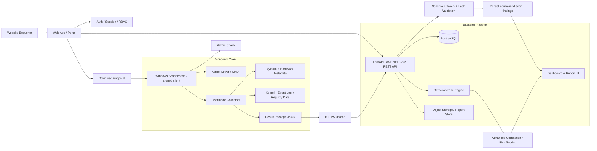

# Architektur und MVP

## Zielarchitektur

```text
driver/       KMDF telemetry, bounded ring buffer, secure IOCTL
service/      kernel client, artifact collectors, timeline, correlation
models/       artifact, kernel event, finding, scan
parsers/      setupapi, event XML, metadata
database/     SQLite schema and evidence package metadata
gui/          dashboard, timeline, findings, report viewer
tests/        fixtures, IOCTL fuzzing, collector/scoring tests
```

Der aktuelle KMDF-Slice liegt in `driver/`; der bestehende PowerShell-Collector ist der Usermode-MVP. Ein echter Service und eine GUI folgen erst nach erfolgreichem WDK-Test.

## MVP in dieser Iteration

- PowerShell 5.1+ ohne externe Pakete.
- Read-only: PCI/PnP, Slots, Security Posture, Treiberdateien/Signaturen und SetupAPI-Installationszeilen.
- Scan-Modi `QUICK`, `DEEP`, `FULL`; QUICK vermeidet breite Dateisystemsuche.
- Einheitliches Artifact-Modell mit Quelle, Pfad, Zeit, Hash, IDs, Erklärung und Konfidenz.
- Timeline aus erkannten SetupAPI-Installationen und aktuellen Artefakten.
- Regelbasierte, erklaerbare Findings mit False-Positive-Hinweisen.
- JSON, CSV und HTML; Evidence Package speichert nur Metadaten, keine Binärdateien.

## Folgeschritte

Der nächste Slice ist ein echter Usermode-KernelClient mit IOCTL-Längenprüfungen, Event-Gap-Erkennung und SQLite-Persistenz. Danach folgen Eventlog-XML, Registry, Prefetch/Amcache und Prozess-/Image-Telemetrie. Prefetch/Amcache brauchen versions- und parserbewusste Verarbeitung und dürfen nicht durch Dateinamen-Suchen simuliert werden. Eine GUI folgt erst, wenn Collector-Verträge und Report-Schema stabil sind.

## Sicherheitsmodell

Keine Funktionen zum Löschen, Deaktivieren, Spoofen, Umgehen oder Testen der Umgehbarkeit. Alle Pfade werden nur gelesen. Rohdaten werden begrenzt und als potentiell personenbezogen behandelt.

## Phase 0: Client-Server-Plattformarchitektur

### 1) End-to-End-Architektur



### 2) Trust Boundaries und Sicherheitsprinzipien

- Client und Kernel-Driver sind nur für Sammlung, Normalisierung und lokale Bereinigung zuständig.
- Der Server akzeptiert nur validierte Uploads mit gültigem Scan-Token, Schema-Version, Hash, Size-Check und Zeitstempel-Checks.
- Der Client darf keine sensiblen Daten wie Cookies, Browser-Verlauf, private Dateien, Passwörter oder vollständige Memory-Images standardmäßig sammeln.
- Der Server behandelt Client-Daten als untrusted input und führt Validierung, Korrelation und Risk-Scoring erneut durch.
- Die finalen Findings und der Report werden serverseitig erzeugt, damit Regeln zentralisiert und versioniert werden können.

### 3) Aufruffluss über die ganze Scan-Session

1. Website erzeugt eine Scan-Session und einen kurzlebigen Upload-Token.
2. Backend liefert signierten Download-Link für den Windows Scanner.
3. Scanner.exe prüft Admin-Rechte und die minimale Server-Version.
4. Scanner validiert den Scan-Token gegen die Scan-Session auf dem Backend.
5. Scanner installiert bzw. startet den signierten KMDF-Treiber.
6. Client sammelt Hardware-, Driver-, Security- und Event-Metadaten.
7. Client baut ein strukturiertes Result-Paket mit canonicalisiertem JSON.
8. Client berechnet SHA-256, verschlüsselt das Paket und sendet es über HTTPS an den Backend-Upload-Endpunkt.
9. Server validiert Scan ID, Token, Schema, Hash, Scanner-Version, Payload Größe und Zeitfenster.
10. Server speichert das Ergebnis, normalisiert es und erzeugt zusätzliche Findings.
11. Website zeigt Report, Timeline, Findings, Hardware und Security-Karten an.

### 4) API-Schnittstellen

#### 4.1 Authentifizierung und Session-Modelle

- Website-Login: Benutzerkonto mit Rollenmodell.
- Scan-Session: erzeugt beim Klick auf Scan starten; enthält user_id, scan_id, upload_token, expires_at, status.
- Upload-Token: nur für genau einen Scan, zeitlich begrenzt, nicht als allgemeiner API-Key.
- Admin-Rollen: optionales RBAC für Operatoren und Support.

#### 4.2 REST API

```text
POST /api/v1/auth/login
POST /api/v1/auth/logout
GET  /api/v1/me

POST /api/v1/scans
GET  /api/v1/scans/{scan_id}
GET  /api/v1/scans
GET  /api/v1/scans/{scan_id}/report
GET  /api/v1/scans/{scan_id}/findings
POST /api/v1/scans/{scan_id}/results
GET  /api/v1/scanner/version
GET  /api/v1/scanner/download

GET  /api/v1/admin/overview
GET  /api/v1/admin/scans
GET  /api/v1/admin/health
```

#### 4.3 Request / Response Contracts

##### POST /api/v1/scans

Request:

```json
{
  "user_id": "uuid",
  "scan_mode": "QUICK",
  "platform": "windows",
  "locale": "de-DE"
}
```

Response:

```json
{
  "scan_id": "550e8400-e29b-41d4-a716-446655440000",
  "status": "CREATED",
  "upload_token": "opaque-token",
  "expires_at": "2026-09-17T12:05:00Z",
  "download_url": "https://example.com/download/scanner.exe",
  "created_at": "2026-09-17T11:59:00Z"
}
```

##### POST /api/v1/scans/{scan_id}/results

Header:

```text
Authorization: Bearer <scan-upload-token>
Content-Type: application/json
Content-Encoding: gzip
```

Body:

```json
{
  "schema_version": 1,
  "scan": {
    "scan_id": "550e8400-e29b-41d4-a716-446655440000",
    "start_time": "2026-09-17T11:59:00Z",
    "end_time": "2026-09-17T12:02:12Z",
    "scanner_version": "1.4.2"
  },
  "system": {},
  "security": {},
  "pci_devices": [],
  "drivers": [],
  "kernel_events": [],
  "device_history": [],
  "execution_artifacts": [],
  "event_logs": [],
  "timeline": [],
  "findings": [],
  "statistics": {}
}
```

Server-Validierung:

- Scan existiert
- Token gültig und noch nicht abgelaufen
- Scan status noch nicht COMPLETED oder FAILED
- JSON-Schema valid
- Payload-Größe innerhalb Limits
- result_hash matcht payload
- Scanner-Version unterstützt
- Timestamps plausibel und nicht in der Zukunft
- Duplicate Events und Event Ordering werden überprüft

### 5) Result Package Contract

```json
{
  "schema_version": 1,
  "scan": {
    "scan_id": "uuid",
    "start_time": "iso8601",
    "end_time": "iso8601",
    "scanner_version": "1.4.2",
    "scan_mode": "STANDARD"
  },
  "system": {
    "computer_name": "string",
    "os_version": "string",
    "architecture": "x64",
    "secure_boot": true,
    "vbs": true,
    "product_name": "string"
  },
  "security": {
    "device_guard": "enabled",
    "core_isolation": "unknown",
    "driver_signing_policy": "windows-default"
  },
  "pci_devices": [],
  "drivers": [],
  "kernel_events": [],
  "device_history": [],
  "execution_artifacts": [],
  "event_logs": [],
  "timeline": [],
  "findings": [],
  "statistics": {
    "device_count": 0,
    "driver_count": 0,
    "event_count": 0,
    "finding_count": 0
  },
  "result_hash": "sha256-hex"
}
```

Jeder Finding ist wie folgt definiert:

```json
{
  "id": "uuid",
  "severity": "HIGH",
  "category": "DRIVER",
  "title": "Unsigned or anomalous kernel-related component",
  "description": "Driver metadata is inconsistent with expected security posture.",
  "timestamp": "2026-09-17T12:00:31Z",
  "confidence": 85,
  "source": "kernel-monitor",
  "evidence": [
    { "type": "driver", "value": "example-driver.sys" }
  ],
  "related_events": ["evt-001", "evt-002"],
  "legitimate_explanations": [
    "Driver is part of a supported OEM package",
    "Safe workload loaded during system startup"
  ]
}
```

### 6) Datenbankmodell

#### Tabellen und Beziehungen

```text
users
  id (PK)
  email
  password_hash
  role
  created_at

scans
  id (PK)
  user_id (FK -> users.id)
  status
  scan_mode
  scan_id
  created_at
  started_at
  completed_at
  scanner_version
  platform
  error_message

scan_tokens
  id (PK)
  scan_id (FK -> scans.id)
  token_hash
  expires_at
  used_at
  revoked_at

systems
  id (PK)
  scan_id (FK -> scans.id)
  computer_name
  os_version
  architecture
  secure_boot
  vbs_state
  created_at

devices
  id (PK)
  scan_id (FK -> scans.id)
  vendor_id
  device_id
  pnp_id
  class_name
  friendly_name
  status

drivers
  id (PK)
  scan_id (FK -> scans.id)
  name
  path
  version
  signer
  hash_sha256
  status

events
  id (PK)
  scan_id (FK -> scans.id)
  source
  event_type
  timestamp
  category
  raw_metadata_json

findings
  id (PK)
  scan_id (FK -> scans.id)
  severity
  category
  title
  description
  confidence
  source
  evidence_json
  timestamps

timelines
  id (PK)
  scan_id (FK -> scans.id)
  timestamp
  category
  title
  severity
  source
  metadata_json

scanner_versions
  id (PK)
  version
  minimum_supported
  latest
  release_notes
  published_at

audit_logs
  id (PK)
  user_id
  scan_id
  action
  ip
  user_agent
  created_at
```

Die Beziehungen folgen der gewünschten Datenmodell-Logik:

```text
User -> Scan -> System
Scan -> Devices
Scan -> Drivers
Scan -> Events
Scan -> Findings
Scan -> Timeline
```

### 7) Client-Schnittstelle (Scanner.exe)

#### 7.1 Lebenszyklus des scanners

```text
Startup
  -> Validate OS + admin rights
  -> Check server version
  -> Validate scan session / token
  -> Check whether driver is already installed
  -> Install/repair driver if necessary
  -> Start service
  -> Begin telemetry collection
  -> Gather Windows artifacts
  -> Create canonical result package
  -> Hash and sign payload if enabled
  -> Upload over HTTPS
  -> Process server confirmation
  -> Stop driver + cleanup temp files
  -> Exit
```

#### 7.2 Progress States

```text
INITIALIZING
CHECKING_SYSTEM
STARTING_KERNEL_MONITOR
ANALYZING_PCI_DEVICES
ANALYZING_DRIVERS
ANALYZING_WINDOWS_ARTIFACTS
BUILDING_TIMELINE
CORRELATING_FINDINGS
GENERATING_REPORT
UPLOADING_RESULTS
COMPLETE
```

Fortschritt: 0 – 100 % mit explizitem Status-Text und Log-Datei `scanner.log`.

#### 7.3 Client Logging und Privacy

- `scanner.log` enthält Start, Version, Scan-Session-ID, Module-Status und Fehler.
- Keine Klartext-Tokens, keine Cookies, keine Passwörter, keine privaten Dateiinhalte.
- Auf Fehler oder Offline-Status: lokal persistieren, später Retry; kein Scan-Verlust.

### 8) Kernel Driver und Telemetrie-Grundlagen

Der KMDF-Treiber ist nur ein defensives Telemetrie-Modul und darf keine Kernel-Memory-Reads, no arbitrary instrumentation, no anti-cheat bypasses, no hooking patterns and no process manipulation. Zulässig sind:

- PCI / PCIe Geräte-Enumerierung
- PnP-Events
- Driver Load Telemetrie
- Process Creation Metadata
- Image Load Metadata
- relevante Registry- und Driver-Änderungen
- Security State und Signaturstatus

Das Treiber-Interface ist durch sichere IOCTLs, Längenprüfung und Ringbuffer mit begrenzter Größe zu schützen.

### 9) Server-side Detection Engine

```text
Client
  Collection
  Normalization
  Basic Correlation
    ->
Server
  Advanced Correlation
  Detection Rules
  IOC Database
  Risk Classification
  Report Rendering
```

Regelmodell:

```json
{
  "rule_id": "uuid",
  "rule_version": "1.0.0",
  "category": "DRIVER",
  "conditions": ["driver_signer == unknown", "path matches system32"],
  "severity": "HIGH",
  "confidence": 87,
  "description": "Kernel-related driver has no valid Authenticode metadata.",
  "false_positive_notes": [
    "Some vendor tools are installed outside trusted stores"
  ]
}
```

### 10) Website- und Reporting-Design

#### Seiten

- Home
- Scan starten
- Downloads
- Scan History
- Scan Report
- Account
- Admin Dashboard

#### Report Header

- Scan ID
- Computer
- Windows Version
- Scanner Version
- Scan Start
- Scan Duration
- Risk Summary

#### Report Tabs

- Overview
- Hardware
- PCI / PCIe
- Drivers
- Kernel
- Execution
- Timeline
- Findings
- Security

#### Findings-Tabelle

- Severity
- Finding
- Category
- Confidence
- Timestamp
- Source

Beim Klick auf einen Eintrag: Beschreibung, Warum flagged, Evidenz, Related Events, mögliche legitime Erklärung, Rohmetadaten.

### 11) Timeline-Design

Die Timeline muss interaktiv und filterbar sein. Beispiel:

```text
13:41:20  PCI device detected
13:41:21  Driver associated
13:41:24  Kernel image loaded
13:42:01  Executable started
13:42:22  Game started
```

Filter:

- Hardware
- Driver
- Kernel
- Process
- Registry
- Windows Event
- Filesystem

Farben basieren nur auf Severity-Kategorie, niemals auf ein absolutes Vertrauensgewicht ohne Erklärbarkeit.

### 12) Security Controls

- Rate Limiting
- Authentication + Authorization
- CSRF Protection
- Input Validation
- SQL Injection Protection
- Audit Logs
- Secure Headers
- Token Expiration
- Upload Size Limits
- Multi-Tenancy: jeder Scan gehört nur zum jeweiligen user_id
- Admins erhalten über RBAC zusätzliche Rechte, aber ohne Zugriff auf private rohe Daten

### 13) Download Security und Version Management

- Signierte Scanner.exe und Installer
- Website zeigt Version, SHA-256, Build Date, Publisher
- Backend verwaltet latest_version und minimum_supported
- Scanner ruft beim Start `GET /api/v1/scanner/version` auf
- Wenn zu alt: Update erforderlich
- Keine unversionierte, zufällige Build-Verteilung

### 14) Entwicklungsreihenfolge

1. Backend API + PostgreSQL
2. Scan Session + Token System
3. Einfacher Scanner Client ohne Kernel Driver
4. Result Upload
5. Web Report
6. KMDF Driver integrieren
7. PCI / PnP Telemetry
8. Driver Load Telemetry
9. Windows Artifact Collection
10. Timeline Engine
11. Detection Engine
12. Digital Signing
13. Production Security Hardening

### 15) PCIe Device Identity / Firmware Masquerading Rules

#### 15.1 Kernregel

> Ein PCIe-Gerät kann seine vom Host sichtbare Identität über Firmware bereitstellen. Deshalb darf Windows nur als die Identität des Geräts gegenüber dem Betriebssystem gesehen werden, nicht als die physische, unverfälschte Originalidentität der Hardware. Ein Vendor ID, Device ID oder FriendlyName allein beweist keine tatsächlich physische Identität des Geräts.

Darauf basierend gilt für die Plattform:

- Der Scanner darf niemals behaupten: "VEN_xxxx DEV_xxxx = echte Hardware X".
- Der Scanner darf nur behaupten: "Das Gerät identifiziert sich gegenüber Windows als Hardware X."
- Die Aussage muss in der Evaluation als Identitätsdarstellung interpretiert werden, nicht als physische Authentizität.

#### 15.2 Multi-Source Device Verification

Für jedes PCIe-Gerät müssen mindestens die folgenden Informationsquellen korreliert werden:

- Device Instance ID
- Hardware IDs
- Compatible IDs
- Vendor ID
- Device ID
- Subsystem Vendor ID
- Subsystem Device ID
- Revision
- Device Class
- Class GUID
- Bus Number
- Device Address
- Location Path
- Parent Device
- PCIe Topology
- Driver
- INF
- Driver Provider
- Driver Version
- Driver Signature
- Friendly Name
- Bus-reported description
- Resource assignments
- Interrupt resources
- Memory resources
- DMA Remapping Policy

Das Ziel ist nicht das Suchen nach einer bekannten DMA Vendor ID, sondern die Prüfung, ob die Identität des Geräts intern konsistent ist.

#### 15.3 Identity Consistency und Device / Driver Mismatch

Der Scanner prüft systematisch:

- Vendor/Device ID vs. Subsystem ID vs. Device Class
- Treiber vs. behauptete Geräteklasse
- INF-Datei vs. Bus Description
- Windows Device Properties vs. historischer Zustand
- erwartet funktionale Gerätesichtbarkeit vs. tatsächlich vorhandenen Gerätsschnittstellen

Beispiele für Findings:

- DEVICE_IDENTITY_INCONSISTENT
- DEVICE_DRIVER_MISMATCH
- DEVICE_CLASS_MISMATCH
- CLASS_FUNCTION_MISMATCH
- RESOURCE_PROFILE_CHANGE
- DEVICE_IDENTITY_ANOMALY
- RECENT_DEVICE_INSTALLATION
- NEW_PCIE_DEVICE
- UNEXPECTED_PCIE_ENDPOINT
- TOPOLOGY_CHANGED

Diese Kategorien sind Anomalieindikatoren, keine automatische Bestätigung für DMA-Cheating.

#### 15.4 Funktionale Konsistenz und Baseline

Für jedes Gerät werden zusätzliche Funktionalitätsprüfungen ergänzt:

- Netzwerkgerät: NDIS Bindings, Network Adapter Interfaces, Passende Treiber
- Storage Controller: tatsächliche Storage-Devices und Stack
- Audio Controller: Audio-Endpunkte und Interfaces
- USB Controller: USB Device Tree

Fehlende Funktion ist nur ein Anomalieindikator, kein Beweis für Manipulation.

#### 15.5 Topologie- und Baseline-Analyse

Für jedes PCIe-Gerät werden Parent/Child-Relationen, Root Complex, Root Port, Bridge, Endpoint und Location Path erfasst. Die relevante Analyse ist:

- neue Endpoint an bekannter Position
- plötzliches Auftreten an einem bisher leeren Slot
- Gerät verschiebt sich in der Topologie
- von früher bekannter Identität zu anderer Identität am selben Pfad

Typische Findings:

- PCI_TOPOLOGY_CHANGED
- DEVICE_MOVED_PORT
- DEVICE_APPEARED
- DEVICE_DISAPPEARED
- DEVICE_LOCATION_CHANGED
- IDENTITY_CHANGE_AT_LOCATION

Eine vertrauenswürdige Erst-Scan-Baseline ist daher für die Folgeanalyse kritischer als ein einzelner Geräte-Name.

#### 15.6 Installation History / SetupAPI

Windows SetupAPI-Logs sind für den Nachweis von Installationshistorien wichtig. Sie dokumentieren:

- Device Instance
- Hardware ID
- Driver Package
- INF
- Installation Timestamp
- Driver Signing Information
- Installation Result

Diese historische Sicht ist wichtig, weil ein Gerät zwar als bekannte Hardware erscheint, aber erst kurz vor dem Scan installiert wurde. Dieses Muster erzeugt ein Finding wie:

- RECENT_DEVICE_INSTALLATION

Ohne automatische Klassifizierung als DMA-Gerät.

#### 15.7 DMA Remapping / IOMMU / Security Posture

Der Scanner erfasst als Sicherheits- und Charakterisierungsdaten:

- DEVPKEY_Device_DmaRemappingPolicy
- Kernel DMA Protection
- IOMMU
- VT-d / AMD-Vi
- VBS
- HVCI

Diese Werte sind relevant als Security Posture, aber sie beweisen nicht, dass ein Gerät als DMA-Cheat-Board fungiert. Sie unterstützen nur die Gesamtinterpretation.

#### 15.8 Evidence Model und Findings-Taxonomie

Die Platform darf keine generische Regel wie "DMA card found" implementieren. Stattdessen werden präzise Findings erzeugt:

- NEW_PCIE_DEVICE
- DEVICE_IDENTITY_CHANGED
- PCI_TOPOLOGY_CHANGED
- DEVICE_DRIVER_MISMATCH
- DEVICE_CLASS_MISMATCH
- DEVICE_FUNCTION_MISMATCH
- DMA_REMAP_INCOMPATIBLE
- RECENT_DEVICE_INSTALL
- UNKNOWN_DRIVER
- DRIVER_SIGNATURE_ANOMALY
- RESOURCE_PROFILE_CHANGED
- IDENTITY_CHANGE_AT_LOCATION
- CORRELATED_HARDWARE_EVENT

Diese Findings müssen als forensische Indikatoren mit erklärbarer Legitimation dokumentiert werden. Ein einzelnes Ding liefert Low/Informational; mehrere unabhängige Indikatoren können Medium/High Interest erzeugen, aber niemals eine definitive Aussage ohne menschliche Fachprüfung.

#### 15.9 Confidence und Forensische Grenze

- Einzelnes Finding: Low / Informational
- Mehrere unabhängige Findings zusammen: Medium
- Starke Korrelation mit Topologie-, Treiber-, Historie- und Ressourcennull: High Interest

Aber stets gilt:

> Manual forensic review required.

Nicht:

> DMA cheat confirmed.

#### 15.10 Technische Kerngrenze

Die Plattform muss explizit dokumentieren, dass ein PCIe-Endpunkt, dessen Firmware überzeugend die erwarteten PCIe-Konfigurations- und Geräteinformationen emuliert, aus Sicht von Windows wie das emulierte Gerät erscheinen kann. Es gibt daher keine universelle Windows-forensische Eigenschaft, die immer die physische Originalidentität einer Karte offenlegt.

Die Erkennung basiert deshalb auf:

- Baseline-Abweichungen
- Topologie
- Gerätehistorie
- Treiberhistorie
- Funktionsinkonsistenzen
- DMA-Security-State
- Ressourcenprofilen
- zeitlicher Korrelation

Nicht auf einer einzelnen, unzuverlässigen Identitätsangabe oder einer "Magic DMA Detection"-Logik.

### 16) Recommended Implementation Baseline

- Backend: FastAPI
- Database: PostgreSQL
- Frontend: modern React / Next.js dashboard with report viewer
- Scanner Client: native C++ or Rust, signed Windows EXE
- Driver: KMDF with secure IOCTL and bounded ring buffer
- Validation: strict JSON schema + canonicalization + SHA-256 verification
- Storage: Postgres for metadata; optional object storage for evidence exports

### 17) Next Step

Als nächster Schritt wird die technische Baseline konkretisiert: Backend-Skeleton, Datenbank-Migrationen, Scan Session Model, Token-Logik und erster Upload-/Version-Endpoint. Danach folgen die ersten Client- und Driver-Contracts.
