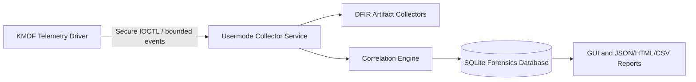

# Kernel-assisted DFIR Architektur

## Datenfluss

## Kernel/Usermode-Trennung

Der Kernel erfasst nur kleine Metadaten und verlässt Callbacks schnell. Er hasht keine Dateien, prüft keine Signaturen, schreibt kein SQLite, greift nicht auf Spielspeicher zu und kommuniziert nicht über Netzwerk. Usermode übernimmt Datei-/Registry-/Eventlog-Analyse, Authenticode, SHA-256, Persistenz, Korrelation und Darstellung.

Der Kernel-Treiber ist Beobachter, kein Blockierer. Er verändert keine Geräte, Treiber, Prozesse oder Logs.

## Dokumentierte APIs

| Aufgabe | API/Mechanismus | Grenze |
|---|---|---|
| KMDF Einstieg | `WdfDriverCreate`, `EvtDeviceAdd` | WDK erforderlich |
| Device Interface | `WdfDeviceCreateDeviceInterface` | ACL wird auf dem Device Object gesetzt |
| IOCTL Queue | `WdfIoQueueCreate`, `EvtIoDeviceControl` | METHOD_BUFFERED, feste Versionen |
| PnP Interface Events | `IoRegisterPlugPlayNotification` | Nur registrierte Interface-Klassen; kein universeller Hardware-Sensor |
| Kernel Images | `PsSetLoadImageNotifyRoutine` | Registrierung nur in Kernel, Metadaten begrenzen |
| Prozesse | `PsSetCreateProcessNotifyRoutineEx` | optional, Datenschutz und Performance beachten |
| Registry | `CmRegisterCallbackEx` | gezielte Pfadfilter, nur Metadaten |

Callbacks werden beim Unload zuverlässig deregistriert. Alle Puffer sind NonPagedPoolNx mit Pool Tag und bounded capacity.

## Sicherheitsmodell

- Device ACL: nur `SYSTEM` und lokale Administratoren.
- Jede Anfrage prüft IOCTL-Code, Input-/Output-Länge, Strukturversion und Größenüberläufe.
- Keine User Pointer im Kernel dereferenzieren.
- Keine Read/Write-Physical-Memory-, Prozessspeicher-, MSR-, PCI-Config-Write- oder Mapping-IOCTLs.
- `CLEAR_SESSION_BUFFER` leert ausschließlich den privaten Telemetriepuffer dieses Treibers.
- Session-ID und monotone Sequenznummern erlauben Usermode, Event-Gaps zu erkennen.

## Limitierungen

Ein KMDF-PnP-Callback liefert nicht automatisch eine vollständige historische PCI-Konfiguration. Persistente Historie kommt aus Usermode-Quellen wie SetupAPI, Registry und EVTX. Kernel-Telemetrie ist daher ein Live-Signal und kein Ersatz für klassische DFIR-Artefakte.
